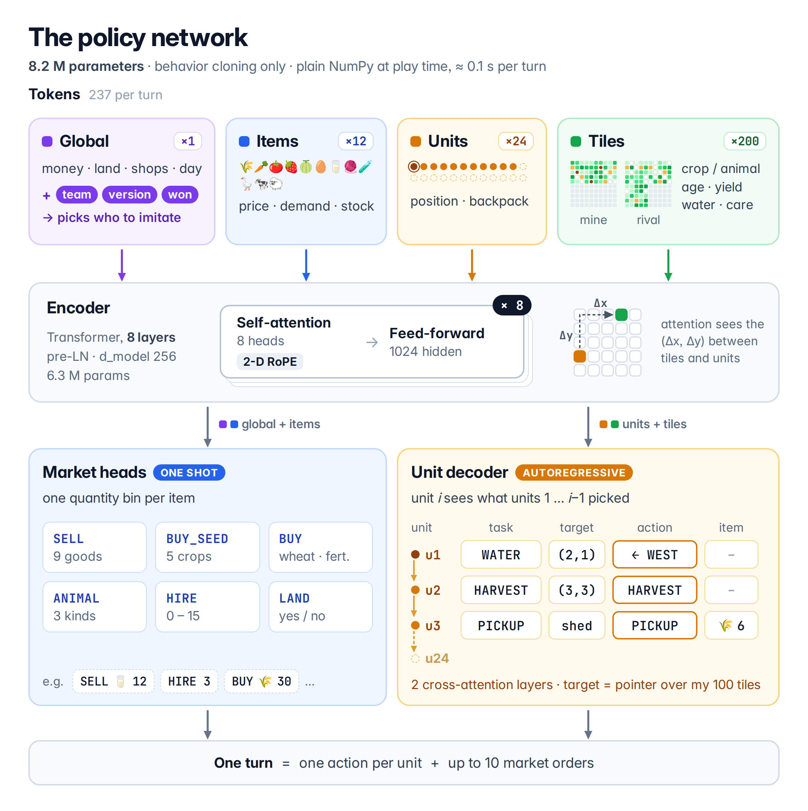

# Kaggriculture: behaviour cloning with an entity Transformer

Team **DECEM** · 7th on the final leaderboard · [Write-up](https://www.kaggle.com/competitions/kaggriculture/discussion/745367) · [Final agents](https://www.kaggle.com/datasets/zy1343930734/kaggriculture-decem-final-agents) · [Kaggle profile](https://www.kaggle.com/zy1343930734) · [中文](README_zh.md)

Training and evaluation code for a [Kaggriculture](https://www.kaggle.com/competitions/kaggriculture) agent. The policy is an 8.2M-parameter entity Transformer trained by behaviour cloning on replays of strong agents, conditioned on team, date bucket and game outcome. At play time it imitates the strongest team's latest version, runs on numpy only (about 0.1 s per turn on Kaggle's CPU) and adds two small rules that stop the engine from destroying goods. The weights of our two final submissions are on Kaggle, see [Final agents](#final-agents).



Training has three stages:

1. **Pretrain** on every trainable seat of roughly the last two weeks of games, sampled with a 3-day recency half-life.
2. **Fine-tune** on the most recent day.
3. **Specialise** on one team's seats only, from the games of its latest few versions, early-stopped on validation loss.

## Final agents

The two agents we had in play at the end of the competition are in the Kaggle dataset [kaggriculture-decem-final-agents](https://www.kaggle.com/datasets/zy1343930734/kaggriculture-decem-final-agents) (CC BY 4.0):

| folder | submitted (UTC) | specialisation data |
|---|---|---|
| `sub-2026-09-30-1908` | 2026-09-30 19:08 | the target team's latest six versions, 645 games; the final score comes from this one |
| `sub-2026-09-30-1046` | 2026-09-30 10:46 | its latest five versions, 573 games |

Both start from the same pretrained and fine-tuned checkpoint with the same specialisation config; only the data differs. Each folder holds a ready agent (`main.py`, `weights.npz`, `vocab.json`; `scripts/package.py` turns the folder into a submission) and `checkpoint.pt`, which works with `scripts/build_agent.py` and as `init` in a config.

`weights.npz` and `vocab.json` are byte-identical to the submitted files. `main.py` was regenerated from `checkpoint.pt` with `scripts/build_agent.py` (`--date 41 --topk 8`, team as set in the released `main.py`) and plays the same actions as the submitted one on the official engine.

```python
from kaggle_environments import make

env = make("kaggriculture", configuration={"seed": 42})
env.run(["sub-2026-09-30-1908/main.py", "random"])   # main.py finds weights.npz next to itself
print([s.reward for s in env.steps[-1]])
```

## Layout

```
train.py                  training entry point for all three stages
configs/                  pretrain.yaml, finetune.yaml, specialize.yaml
src/
  common.py               constants, observation -> raw arrays -> model features (numpy)
  extract.py              replay JSON -> per-episode npz
  labels.py               per-episode npz -> BC labels
  data.py                 episode pool sampler, validation set
  model.py                BCNet (torch)
  npmodel.py              the same forward pass in numpy
  policy.py               decoding, legality masks, market orders, the two rules
  optim.py                Muon / AdamW parameter grouping
  muon.py, newton_schulz.py   Muon optimizer and Newton-Schulz orthogonalisation
  export.py               checkpoint -> weights.npz + vocab.json
scripts/
  build_census.py         replays -> census.jsonl + episode / label caches + team vocabulary
  build_agent.py          checkpoint -> submission directory (single-file main.py)
  check_numpy.py          numpy vs torch parity, per-step latency
  package.py              tar.gz + checks on the official engine
tools/
  build_worlds.py         recorded games -> fork-evaluation worlds
  world_fork.py           replay to day N, then let an agent take over one seat
  world_report.py         paired comparison of two agents over the same worlds
```

## Setup

```bash
pip install -r requirements.txt
# optional, for tools/ and package.py --parity: the C++ engine port
pip install git+https://github.com/destbreso/kaggriculture-cppsim
```

Training needs a CUDA GPU; everything else runs on CPU. Tested with Python 3.12, PyTorch 2.14, kaggle-environments 1.32.7.

## Data

The input is a set of episode replay JSON files (the format kaggle-environments writes). A replay's date is taken from its parent directory name, so lay them out as `replays/YYYY-MM-DD/<episode>.json`, or pass `--default-day` for a directory without dates.

```bash
# stages 1 and 2: all teams, your own seats excluded
python scripts/build_census.py --replays replays/ --out data/pretrain --since 2026-09-14 \
    --exclude-teams "<YOUR TEAM>"

# stage 3: only the target team's seats, all in one date bucket, same vocabulary as stage 1;
# leave out games you keep for evaluation
python scripts/build_census.py --replays replays_target/ --out data/specialize --default-day 2026-09-30 \
    --train-teams "<TARGET TEAM>" --seat-day 2026-09-27 --vocab data/pretrain/vocab.json \
    --drop-ids worlds/target.pkl
```

`build_census.py` keeps episodes with 720 steps, no ERROR / TIMEOUT / INVALID status and the given engine version, drops open-loop tapes (a team replaying a byte-identical action stream in two or more episodes), writes `census.jsonl`, `vocab.json` and `report.json`, and fills `cache/ep` and `cache/lab`. A team gets its own embedding with at least `--min-seats` trainable seats; everyone else shares `<other>`. The final agent was pretrained on about 10k episodes; the caches take roughly 200 KB per episode.

Date buckets count days from 2026-08-17 (`src/common.py`). The model has `ndate` of them (42 in the configs, i.e. up to 2026-09-27); later days are clamped into the last bucket. To give individual seats a version-specific bucket, pass `--seat-days` a CSV of `episode_id,seat,day`.

## Training

```bash
python train.py --config configs/pretrain.yaml   --run pretrain     # 30k steps, ~50 min on one RTX 5090
python train.py --config configs/finetune.yaml   --run finetune     # 4k steps on the latest day
python train.py --config configs/specialize.yaml --run specialize   # set ft_teams first; deploy best.pt
```

Each run writes to `runs/<run>/`. Checkpoints hold EMA weights; only EMA weights are evaluated or deployed. `--smoke` runs a few dozen steps with small batches.

Optimisation: Muon (Polar Express coefficients, fp16, fused QKV / KV split into blocks) for hidden 2-D weights, AdamW for embeddings, norms, biases and output heads, one shared warmup + cosine schedule, batch 512, bf16 autocast. Steps whose gradient norm is far above its running reference are skipped. Stages 2 and 3 start from the previous stage's checkpoint and inherit its vocabulary.

## Building and checking a submission

```bash
python scripts/build_agent.py runs/specialize/best.pt agents/final --team "<TARGET TEAM>" --date 41 --topk 8
python scripts/check_numpy.py runs/specialize/best.pt --census data/specialize/census.jsonl --team "<TARGET TEAM>" --date 41
python scripts/package.py agents/final --out artifacts/final.tar.gz --parity
```

`--date` is the bucket the target team's seats were trained under (for `--seat-day 2026-09-27` that is 41). The generated `main.py` wraps every call in `try/except BaseException` and plays PASS on any error, since an uncaught exception ends the episode for the agent. The package is about 30 MB.

## Model

Each turn is encoded from our seat's point of view as 237 tokens:

- 1 global token: both sides' money and the difference, hires, land, unit counts, open shops, day and hour, plus the team, date-bucket and outcome embeddings;
- 12 product / animal tokens: price relative to base, market depletion, shop demand, our shed / bags / seeds, tiles of that crop or animal on each farm;
- 24 unit tokens (farmer + up to 23 hands): position, slot and bag contents; absent units get a "no position" embedding instead of a padding mask;
- 200 tile tokens (100 per farm), each the sum of one small embedding per tile field.

The encoder is 8 pre-LN layers (d 256, 8 heads, FFN 1024) with 2-D axial RoPE: half of each head's rotation pairs turn by tile column, half by row, so attention depends on the offset (dx, dy). Logits are soft-capped at 30·tanh(x/30).

Units are decoded one after another with a 2-layer causal cross-attention decoder over a memory of the previous units' choices. Per unit: task (14 kinds), target tile (pointer over our 100 tiles), raw action (18, moves included, conditioned on task, target and the offset to it), then item and quantity. Only the raw action is executed; task and target let later units see which jobs are taken. Market heads read the encoder output: per-product sell quantities, seed / wheat / fertilizer buys, animals, hires and land, all as classification over quantity bins.

Labels: a unit's task is its first non-move action until the end of the day and the tile it does it on (PASS and the final tile if it only walks); sells are capped at what the shed actually holds after the unit phase; animal buys count only animals that arrived. All heads use cross-entropy with teacher forcing.

Decoding details that matter: the raw action is marginalised over the top-8 (task, tile) plans; legality masks replay the step's earlier unit actions; market quantities go through expected-quantity accumulators so that rare, uncertain-timing purchases still happen.

The two rules: on the last step of each day, sell what the end-of-day bag dump would push past the 100-item shed cap; on the final day, which has no end-of-day dump, bring carried goods back to the shed and drop them in time.

## Evaluation

Fork evaluation on recorded games: both sides replay their recorded actions until the start of day 8, then the agent under test plays our seat while the opponent keeps following its recording. Shops are pinned to the recorded ones, and each world is kept only if the simulator reproduces the recorded result to the dollar.

```bash
python tools/build_worlds.py --replays replays/mine --team "<YOUR TEAM>" --out worlds/mine.pkl
python tools/world_fork.py new=agents/final old=agents/previous --worlds worlds/mine.pkl --day 8 --out results/d8
python tools/world_report.py results/d8/old.jsonl results/d8/new.jsonl
```

`--opponent "<TEAM>"` instead of `--team` builds worlds from that team's games against anyone, with the agent taking the other seat. The report counts strict flips (loss/tie -> win against win -> loss/tie) with a sign test, and splits the change in margin into our money and the opponent's: a change that only makes the opponent earn less can look good on margin and do nothing for wins.

## Acknowledgements

- [kaggriculture-cppsim](https://github.com/destbreso/kaggriculture-cppsim) by destbreso, built on nikital7's bit-exact C++ engine port, used for all simulation in `tools/`.
- Muon: Keller Jordan's [reference implementation](https://github.com/KellerJordan/Muon) (MIT), adapted in `src/muon.py`.
- Newton-Schulz iteration from Dao-AILab's [gram-newton-schulz](https://github.com/Dao-AILab/gram-newton-schulz) (MIT), trimmed in `src/newton_schulz.py`; coefficients from [Polar Express](https://arxiv.org/abs/2505.16932).

## License

CC BY 4.0, see [LICENSE](LICENSE). It covers the code and the released model weights; the competition rules ask prize winners to license the winning submission and the code that produced it under CC BY 4.0. `src/muon.py` and `src/newton_schulz.py` are adapted from MIT-licensed projects credited above, and their original notices are kept in [THIRD_PARTY_NOTICES.md](THIRD_PARTY_NOTICES.md).
