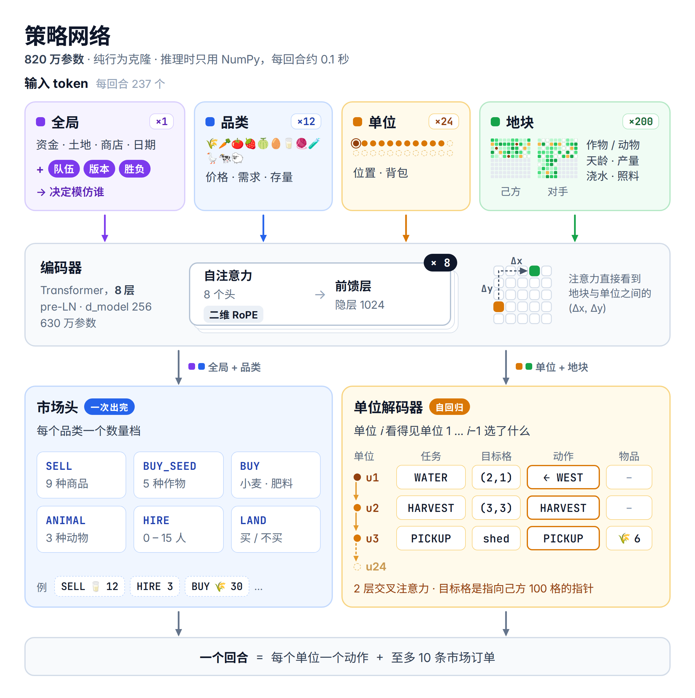

# Kaggriculture：基于实体 Transformer 的行为克隆

队伍 **DECEM** · [Kaggle 主页](https://www.kaggle.com/zy1343930734) · [English](README.md)

这是 [Kaggriculture](https://www.kaggle.com/competitions/kaggriculture) agent 的训练与评测代码。策略是一个 820 万参数的实体 Transformer，用强队 agent 的回放做行为克隆，条件是队伍、日期桶和这局的胜负。对局时它模仿最强那支队伍的最新版本，只依赖 numpy（在 Kaggle 的 CPU 上每回合约 0.1 秒），另外加了两条小规则，防止引擎把货物销毁。



训练分三个阶段：

1. **预训练**：用大约最近两周对局里所有可训练的座位，按 3 天半衰期做近期加权抽样。
2. **微调**：只用最近一天的数据。
3. **专精**：只用一支队伍的座位，数据来自它最新几个版本的对局，按验证损失早停。

## 目录结构

```
train.py                  三个阶段共用的训练入口
configs/                  pretrain.yaml、finetune.yaml、specialize.yaml
src/
  common.py               常量，观测 -> 原始数组 -> 模型特征（numpy）
  extract.py              回放 JSON -> 每局一个 npz
  labels.py               每局 npz -> BC 标签
  data.py                 局池采样器、验证集
  model.py                BCNet（torch）
  npmodel.py              同一套前向的 numpy 实现
  policy.py               解码、合法性掩码、市场订单、两条规则
  optim.py                Muon / AdamW 参数分组
  muon.py, newton_schulz.py   Muon 优化器与 Newton-Schulz 正交化
  export.py               检查点 -> weights.npz + vocab.json
scripts/
  build_census.py         回放 -> census.jsonl + 局 / 标签缓存 + 队伍词表
  build_agent.py          检查点 -> 提交目录（单文件 main.py）
  check_numpy.py          numpy 与 torch 一致性、单步耗时
  package.py              打 tar.gz 并在官方引擎上检查
tools/
  build_worlds.py         录像对局 -> 分叉评测用的世界
  world_fork.py           重放到第 N 天，之后由 agent 接管一方座位
  world_report.py         两个 agent 在同一批世界上的配对比较
```

## 环境

```bash
pip install -r requirements.txt
# 可选，tools/ 和 package.py --parity 需要：C++ 引擎移植
pip install git+https://github.com/destbreso/kaggriculture-cppsim
```

训练需要 CUDA GPU，其余部分都能在 CPU 上跑。测试环境：Python 3.12、PyTorch 2.14、kaggle-environments 1.32.7。

## 数据

输入是一批对局回放 JSON 文件（kaggle-environments 写出的格式）。回放的日期取自它所在目录的名字，所以请按 `replays/YYYY-MM-DD/<episode>.json` 存放；目录名不是日期时，用 `--default-day` 指定。

```bash
# 阶段 1 和 2：所有队伍，排除你自己的座位
python scripts/build_census.py --replays replays/ --out data/pretrain --since 2026-09-14 \
    --exclude-teams "<YOUR TEAM>"

# 阶段 3：只训目标队伍的座位，全部放进同一个日期桶，词表沿用阶段 1；
# 留作评测的对局要排除掉
python scripts/build_census.py --replays replays_target/ --out data/specialize --default-day 2026-09-30 \
    --train-teams "<TARGET TEAM>" --seat-day 2026-09-27 --vocab data/pretrain/vocab.json \
    --drop-ids worlds/target.pkl
```

`build_census.py` 只保留满 720 步、没有 ERROR / TIMEOUT / INVALID 状态、引擎版本符合要求的对局，剔除开环磁带（同一支队伍在两局及以上逐字节重复同一串动作），写出 `census.jsonl`、`vocab.json` 和 `report.json`，并填充 `cache/ep` 与 `cache/lab`。一支队伍至少要有 `--min-seats` 个可训练座位才有自己的嵌入，其余队伍共用 `<other>`。最终 agent 的预训练用了约 1 万局，缓存每局约 200 KB。

日期桶从 2026-08-17 起按天计数（见 `src/common.py`）。模型共有 `ndate` 个桶（配置里是 42，即到 2026-09-27 为止），更晚的日期会被压进最后一个桶。如果想给个别座位指定按版本划分的桶，可以给 `--seat-days` 传一个 `episode_id,seat,day` 格式的 CSV。

## 训练

```bash
python train.py --config configs/pretrain.yaml   --run pretrain     # 30k 步，一张 RTX 5090 约 50 分钟
python train.py --config configs/finetune.yaml   --run finetune     # 在最近一天上训 4k 步
python train.py --config configs/specialize.yaml --run specialize   # 先填好 ft_teams；部署用 best.pt
```

每次训练输出到 `runs/<run>/`。检查点里存的是 EMA 权重，评测和部署都只用 EMA 权重。`--smoke` 用小 batch 跑几十步做冒烟测试。

优化：隐藏层的二维权重用 Muon（Polar Express 系数、fp16，堆叠的 QKV / KV 按块拆开正交化），嵌入、归一化层、偏置和输出头用 AdamW；所有参数组共用一条预热加余弦退火的学习率曲线，batch 512，bf16 autocast。梯度范数远高于滑动参照值的步会被跳过。阶段 2 和 3 从上一阶段的检查点继续训，并沿用它的词表。

## 构建与检查提交

```bash
python scripts/build_agent.py runs/specialize/best.pt agents/final --team "<TARGET TEAM>" --date 41 --topk 8
python scripts/check_numpy.py runs/specialize/best.pt --census data/specialize/census.jsonl --team "<TARGET TEAM>" --date 41
python scripts/package.py agents/final --out artifacts/final.tar.gz --parity
```

`--date` 是目标队伍座位训练时所在的日期桶（`--seat-day 2026-09-27` 对应 41）。生成的 `main.py` 把每次调用都包在 `try/except BaseException` 里，出任何错误就返回 PASS，因为一次未捕获的异常会让 agent 整局报废。提交包约 30 MB。

## 模型

每回合都从我方座位的视角编码成 237 个 token：

- 1 个全局 token：双方资金及其差值、雇工数、土地、单位数、已开的商店、第几天第几小时，再加上队伍、日期桶和胜负三个嵌入；
- 12 个商品 / 动物 token：价格相对基础价的比值、市场库存消耗、商店需求、我方仓库 / 背包 / 种子数量、双方农场上该作物或动物占的格子数；
- 24 个单位 token（农夫加最多 23 个雇工）：位置、槽位和背包内容；不在场的单位用「无位置」嵌入，不用 padding mask；
- 200 个地块 token（每个农场 100 个），每个是地块各字段一张小嵌入表、嵌入相加而成。

编码器是 8 层 pre-LN（d 256、8 头、FFN 1024），用二维轴向 RoPE：每个头里一半的旋转对按格子的列转、另一半按行转，所以注意力取决于相对位移 (dx, dy)。所有 logit 都经过 30·tanh(x/30) 软上限。

单位逐个解码：一个 2 层的因果交叉注意力解码器，记忆里存的是前面各单位已做的选择。每个单位依次输出：任务（14 种）、目标格（在我方 100 格上做指针选择）、原始动作（18 种，含移动，以任务、目标格和到目标的位移为条件），最后是物品和数量。真正执行的只有原始动作；任务和目标格让后面的单位知道哪些活已经有人认领了。市场头直接读编码器输出：每种商品的卖出量，种子 / 小麦 / 肥料的买入量，动物、雇工和土地，全部按数量档做分类。

标签：单位的任务是它从现在到当天结束的第一个非移动动作，以及它做这个动作时所在的格子（如果它只是在走，就是 PASS 加最后停下的格子）；卖出量不超过单位阶段之后仓库里实际有的数量；买动物只算实际到货的只数。所有头都用交叉熵，训练时 teacher forcing。

解码时有几个要紧的细节：原始动作在概率最高的 8 个（任务，目标格）计划上做边缘化；合法性掩码会重放本步前面单位已做的动作；市场数量经过期望数量累加器，这样时机不确定的少见购买也能兑现。

两条规则：每天最后一步，提前从仓库卖掉日终背包倒仓时会超出 100 件上限的货；最后一天没有日终倒仓，把身上带的货及时送回仓库放下。

## 评测

在录像对局上做分叉评测：双方先按录像动作重放到第 8 天开始，之后被测 agent 接管我方座位，对手继续按它的录像动作走。商店固定为录像里的那组，并且只保留模拟器能逐美元复现录像结果的世界。

```bash
python tools/build_worlds.py --replays replays/mine --team "<YOUR TEAM>" --out worlds/mine.pkl
python tools/world_fork.py new=agents/final old=agents/previous --worlds worlds/mine.pkl --day 8 --out results/d8
python tools/world_report.py results/d8/old.jsonl results/d8/new.jsonl
```

把 `--team` 换成 `--opponent "<TEAM>"`，就是用那支队伍对任何对手的对局来建世界，agent 接管它对面的座位。报告统计严格翻局（负 / 平 -> 胜 对 胜 -> 负 / 平）并做符号检验，还把差额的变化拆成我方多赚和对手少赚两部分：只让对手少赚的改动，按差额看很好，对胜场却可能毫无帮助。

## 致谢

- [kaggriculture-cppsim](https://github.com/destbreso/kaggriculture-cppsim)，作者 destbreso，基于 nikital7 的逐位等价 C++ 引擎移植；`tools/` 里的所有模拟都用它。
- Muon：Keller Jordan 的[参考实现](https://github.com/KellerJordan/Muon)（MIT），改写在 `src/muon.py`。
- Newton-Schulz 迭代来自 Dao-AILab 的 [gram-newton-schulz](https://github.com/Dao-AILab/gram-newton-schulz)（MIT），精简在 `src/newton_schulz.py`；系数来自 [Polar Express](https://arxiv.org/abs/2505.16932)。

## 许可证

MIT，见 [LICENSE](LICENSE)。`src/muon.py` 和 `src/newton_schulz.py` 改写自上面致谢中列出的 MIT 许可项目。
